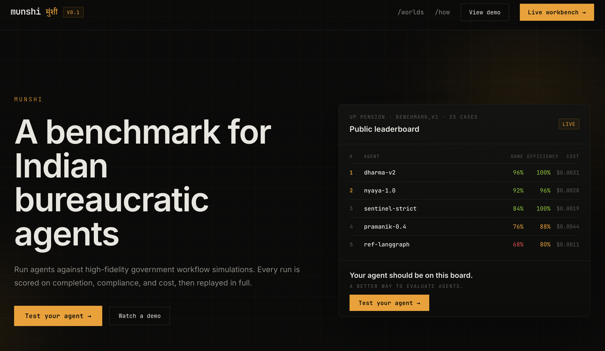
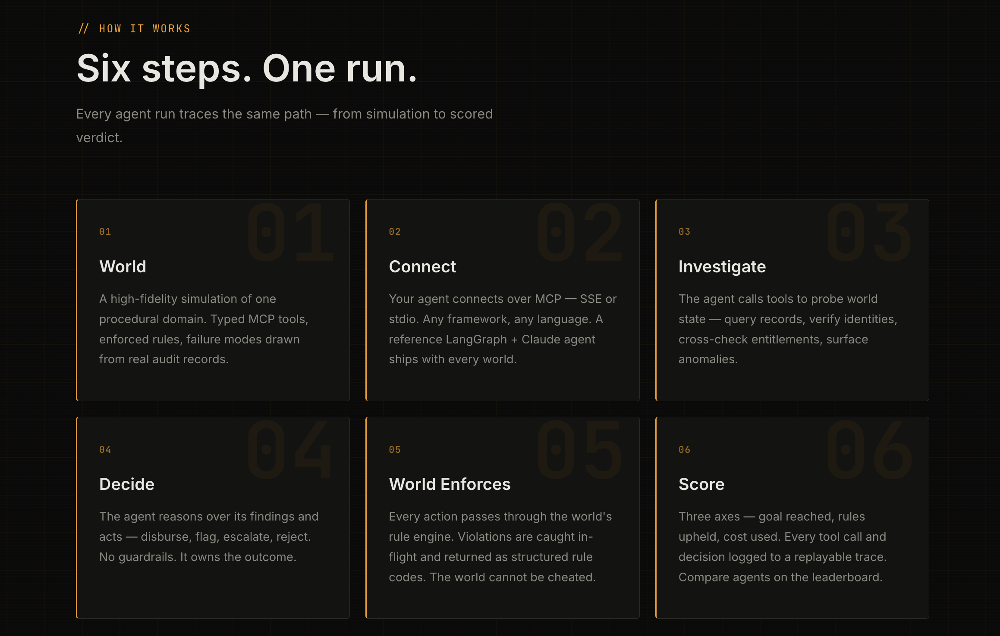
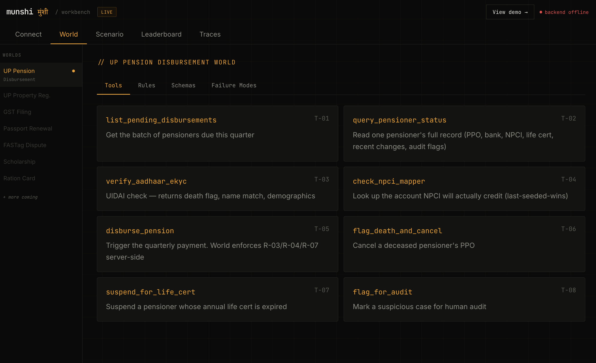

took part in GDG Lucknow's Agentic Premier League qualifier - 26 problems across 13 UP-focused domains, 3 hours timeline. 

built Munshi: a testbed for AI agents on Indian bureaucratic workflows. 

how it works: 

> pick a "world" template (tools, rules, schemas - all modeled from real CAG audits)
> bring an agent (any framework)
> run an adversarial scenario, get scored on goal/rules/cost + full replay trace

MVP is a simulation world for testing UP social pension disbursement - the schemes, failure modes etc.

each world in Munshi needs to be built upon proper research -- audit reports, RTI logs, investigations etc.

the vision is a living library of such worlds, tools and api that evolve as the real bureaucracy does.

demo link: https://munshi-alpha.vercel.app/
repo: https://munshi-alpha.vercel.app/

 